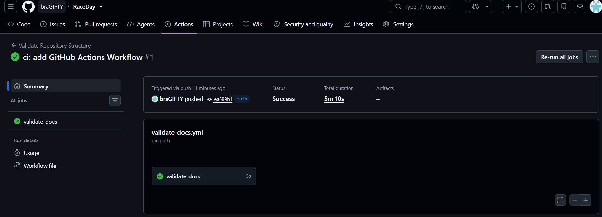
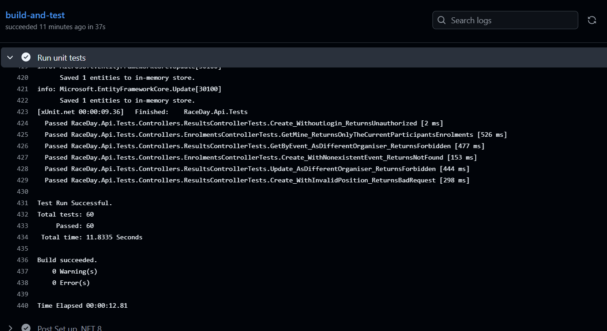
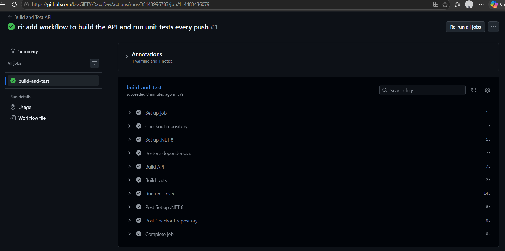

# RaceDay


RaceDay is a full-stack event management platform for South Africa's road running, walking, and cycling community. Event Organisers can create and manage events, define categories, and capture participant results. Participants can browse upcoming events, enter them by selecting a category, and track their own enrolment and results history.

This repository holds the work for each part of the project:

- **Part 1 — System Planning and Database:** the ERD, API endpoint plan, and SQL script, with the reasoning behind each decision. See [`docs/`](docs/).
- **Part 2 — RESTful API:** an ASP.NET Core Web API (.NET 8) built against the Part 1 plan, using Entity Framework Core (Code-First), session-based authentication, Swagger, a unit test suite, and CI. See [`RaceDay.Api/`](RaceDay.Api/) and [`RaceDay.Api.Tests/`](RaceDay.Api.Tests/).
- **Part 3 — MVC front end:** not started yet.

## Roles

- **Organiser** — creates, edits, and deletes events; defines categories for each event; captures participant results; and views all enrolments for their own events.
- **Participant** — registers an account, browses events, enters an event by selecting a category, and views their own enrolments and results.

Role-based access is enforced on the server in the API, not just in the documentation. See [Authentication and role-based access](#authentication-and-role-based-access).

## Repository Structure

```
RaceDay/
├── .github/workflows/
│   ├── validate-docs.yml        # Part 1: checks /docs exists with the required files
│   └── build-and-test.yml       # Part 2: builds the API and runs all unit tests
├── docs/                        # Part 1 deliverables and CI screenshots
│   ├── raceday-erd.png          # Entity Relationship Diagram
│   ├── raceday-erd.pdf          # ERD, PDF version
│   ├── endpoint-plan.md         # API endpoint plan (the Part 2 specification)
│   ├── raceday-schema.sql       # Part 1 SQL script
│   ├── RaceDay System Planning and Database.docx   # Full Part 1 planning document
│   ├── ci-success.png           # Part 1 CI screenshot
│   ├── part2-ci-build.png       # Part 2 CI screenshot (workflow steps)
│   └── part2-ci-tests.png       # Part 2 CI screenshot (unit test results)
├── RaceDay.Api/                 # The Web API
│   ├── Controllers/             # Auth, Users, Events, Categories, Enrolments, Results
│   ├── Data/                    # RaceDayDbContext (EF Core)
│   ├── DTOs/                    # Request and response shapes
│   ├── Filters/                 # [RequireAuth] and [RequireRole] session filters
│   ├── Migrations/              # EF Core Code-First migrations
│   ├── Models/                  # Entity classes
│   ├── Program.cs
│   └── appsettings.json
├── RaceDay.Api.Tests/           # xUnit test project
│   ├── Controllers/             # One test class per controller
│   ├── RaceDayApiFactory.cs     # Starts the API in memory for tests
│   └── TestHelpers.cs
└── README.md
```

## Part 2: Setup and Run

### Prerequisites

- **.NET 8 SDK.** Running `dotnet --list-sdks` should list an `8.x` entry.
- **SQL Server** (Express edition is fine). These instructions assume a local `.\SQLEXPRESS` instance.
- **SQL Server Management Studio** (optional, for looking inside the database).
- **Visual Studio 2022 or later** with the ASP.NET and web development workload (optional, everything also works from the command line).

### 1. Get the code

```
git clone https://github.com/braGIFTY/RaceDay.git
cd RaceDay
```

### 2. Point the API at your SQL Server

Open `RaceDay.Api/appsettings.json` and check the connection string matches your SQL Server instance:

```json
"ConnectionStrings": {
    "RaceDayDb": "Server=.\\SQLEXPRESS;Database=RaceDayDB;Trusted_Connection=True;TrustServerCertificate=True;"
}
```

The backslash is doubled because JSON treats `\` as an escape character. If your server has a different name (for example `(localdb)\\MSSQLLocalDB`), change the `Server=` part only.

### 3. Create the database from the migrations

The database is built by EF Core (Code-First). It does not need to exist beforehand.

**Visual Studio:** open `RaceDay.Api/RaceDay.Api.slnx` (needs a recent Visual Studio), then **Tools → NuGet Package Manager → Package Manager Console**, set **Default project** to `RaceDay.Api`, and run:

```
Update-Database
```

**Command line:**

```
dotnet tool install --global dotnet-ef --version 8.*
cd RaceDay.Api
dotnet ef database update
```

Either route creates `RaceDayDB` with all six tables (Organisers, Participants, Events, Categories, Enrolments, Results). The new database starts empty.

> **Do not run `docs/raceday-schema.sql` against this database.** That is the Part 1 script. It drops and recreates the tables in `RaceDayDB`, which would undo what the migrations built.

### 4. Run the API

**Visual Studio:** set `RaceDay.Api` as the startup project and press **F5**.

**Command line:**

```
dotnet run --project RaceDay.Api --launch-profile https
```

Swagger UI opens at `https://localhost:7146/swagger`. The exact port is set in `RaceDay.Api/Properties/launchSettings.json` and printed in the console when the API starts. If your browser warns about the development certificate, run `dotnet dev-certs https --trust` once.

### Trying the API in Swagger

Swagger runs in your browser, so the session cookie is shared across the page: logging in as a different user replaces the previous session. Use a private/incognito window to test as someone who is logged out.

1. `POST /api/auth/register/organiser`, then `POST /api/auth/login` with the same email and password.
2. `POST /api/events`, then `POST /api/events/{eventId}/categories` using the event's id.
3. `POST /api/auth/register/participant`, then `POST /api/auth/login` as the participant (this replaces the organiser's session).
4. `POST /api/enrolments` with the event id and category id.
5. Log in as the organiser again: `GET /api/events/{eventId}/enrolments`, then `POST /api/enrolments/{id}/results` to record a finish time and position.
6. Log in as the participant: `GET /api/results/me` shows their result.

All 22 endpoints are listed in Swagger with a description, the request body they expect, and every response code they can return. The planned list is in [`docs/endpoint-plan.md`](docs/endpoint-plan.md).

## Authentication and role-based access

- **Registration:** the role is chosen by which endpoint you call, `POST /api/auth/register/organiser` or `POST /api/auth/register/participant`. Passwords must be at least 8 characters and are stored as salted hashes using ASP.NET Core's `PasswordHasher`. The plain password is never stored.
- **Login:** `POST /api/auth/login` checks the Organisers and Participants tables for the email, verifies the password hash, and stores the user's **id and role in a server-side session**. The browser only holds an HttpOnly session cookie. Sessions expire after 30 minutes idle and are held in server memory, so restarting the API logs everyone out.
- **Enforcement:** two filters in `RaceDay.Api/Filters/AuthFilters.cs` run before any protected action:
  - `[RequireAuth]` returns `401 Unauthorized` when there is no session.
  - `[RequireRole("Organiser")]` and `[RequireRole("Participant")]` return `401` when there is no session and `403 Forbidden` when the logged-in user has the other role.
- **Public vs protected:** registration, login, and browsing events and categories are public. Every other endpoint requires an active session.
- **Ownership:** role alone is not enough for edits. An Organiser can only change events (and their categories and results) that they own, and a Participant can only cancel their own enrolments. Anything else returns `403`.
- **One email, one account:** because Organisers and Participants are separate tables, the database cannot enforce a single unique email across both. The API checks both tables at registration and when a profile's email is changed.

## Running the unit tests

There are 60 tests: Auth (6), Events (9), Categories (13), Enrolments (11), Results (12) and Users (9).

**Visual Studio:** **Test → Test Explorer → Run All Tests.**

**Command line:**

```
dotnet test RaceDay.Api.Tests/RaceDay.Api.Tests.csproj
```

SQL Server is not needed to run them. Each test class starts the real API in memory using `WebApplicationFactory` and swaps SQL Server for EF Core's in-memory database. The tests send real HTTP requests through the real routing, filters and controllers, and each simulated user has their own cookie jar, so one test can have an organiser, a second organiser and a participant logged in at once. They cover registration and login, event management, role rejection (`401` and `403`), ownership checks, enrolments, results, and profile updates.

The in-memory database does not enforce SQL-level constraints (unique indexes, check constraints). The tests therefore prove the API's own checks, such as the `409 Conflict` responses and `400 Bad Request` validation, rather than the database's.

## CI/CD

Two GitHub Actions workflows run on every push to `main`:

- **`validate-docs.yml` (Part 1):** confirms the `/docs` folder exists and contains the required files.
- **`build-and-test.yml` (Part 2):** installs the .NET 8 SDK, restores dependencies, builds the API and the test project in Release mode, then runs all 60 unit tests.

Part 1:



Part 2, workflow steps:



Part 2, unit test results:



## Deviations from the Part 1 plan

The API implements the 22 endpoints from [`docs/endpoint-plan.md`](docs/endpoint-plan.md). Where the build differs from the plan, it is listed here.

1. **Session-based login instead of a token.** The plan described `POST /api/auth/login` returning "token and role". The Part 2 brief requires session management, so login now stores the user's id and role in a server-side session and returns the user's details and role with `200 OK`. The route, request body and `401` case are unchanged.
2. **Browsing events and categories does not require a login.** The plan marked `GET /api/events`, `GET /api/events/{id}` and `GET /api/events/{eventId}/categories` as `Any` (any authenticated user). They are implemented as open to everyone, so events can be browsed without an account. All other access rules match the plan.
3. **The database is built by EF Core migrations (Code-First).** The brief requires Code-First, so the live database comes from `RaceDay.Api/Migrations`, not from `docs/raceday-schema.sql`. Tables, columns, data types, keys, unique rules, check rules and defaults match the Part 1 script. Constraint and index names differ because EF Core generates its own (for example unique indexes in place of named `UNIQUE` constraints), and EF Core adds indexes on foreign-key columns. The migration-built database starts empty, so the Part 1 sample data is not carried over.
4. **Delete behaviour on foreign keys.** The Part 1 script did not specify `ON DELETE`, so SQL Server defaulted every foreign key to `NO ACTION`. EF Core cascades by default on required relationships, so five keys now use `ON DELETE CASCADE`: Organiser → Events, Event → Categories, Category → Enrolments, Participant → Enrolments and Enrolment → Result. The sixth, Enrolments → Events, is set to `NO ACTION`, because Enrolments reaches Events by two routes (directly, and through Categories) and SQL Server refuses to create two cascade paths to the same table. Deleting an event still cleans up its categories, and their enrolments, through the Categories route.
5. **Extra checks beyond the plan.** Added `400 Bad Request` validation (password minimum 8 characters, `EventType` limited to Run/Walk/Cycle, distance range, result position of at least 1), a `409 Conflict` for a duplicate category name on the same event, and a `409 Conflict` when a profile update uses an email that already belongs to another account.
6. **Cancelling an enrolment deletes it.** `DELETE /api/enrolments/{id}` removes the row. The `Cancelled` value allowed in the Status column (from Part 1) is not currently used.

## Part 1: Planning and Database

Part 1 is the specification Part 2 was built from. The ERD, the endpoint plan, the SQL script and the written reasoning for each are in [`docs/`](docs/). The full write-up is `docs/RaceDay System Planning and Database.docx`.

To look at the Part 1 database on its own, open `docs/raceday-schema.sql` in SQL Server Management Studio and execute it. It creates `RaceDayDB`, all six tables, and sample data. As noted in the setup steps, run it on a SQL Server instance where you have not already created the Part 2 database, because it drops and recreates the tables.

## Video Walkthroughs

- [Part 1 video walkthrough](https://youtu.be/US8X2dPBVJo)
- [Part 2 video walkthrough](https://youtu.be/eBEc5hjMr5M)
